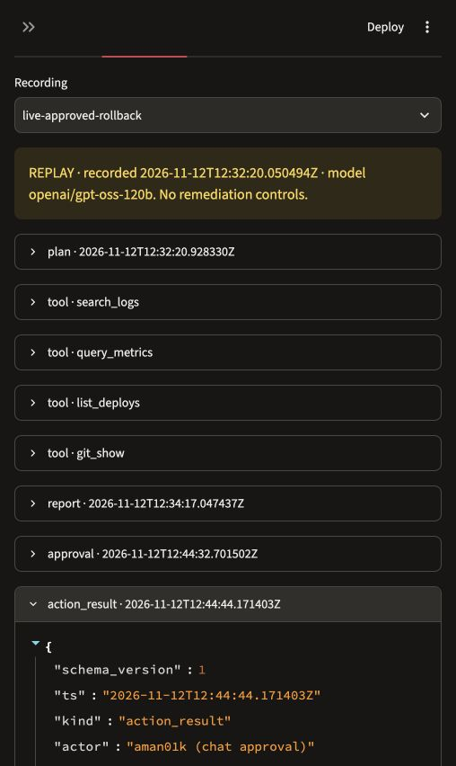

# Assessment presentation notes

Suggested duration: about seven minutes plus questions. Author: aman01k.

## 1. OnCall Agent
Explain that this is a local incident investigation prototype for the Professional Development Course. The model selects evidence tools and proposes recovery. A person approves changes. Do not claim production accuracy.

## 2. The incident context problem
An alert identifies a symptom, but the engineer still needs logs, metrics, deployment history and relevant runbooks. The project targets small teams without dedicated SRE support. The initial 30–60 minute estimate is not measured evidence, so leave it out of numerical claims.

## 3. Investigation workflow
Describe the loop in agent/runner.py: provide tools, get the model's selected call, execute a read-only function, return the result, then repeat. The model chooses arguments and follow-ups. Public plans and tool calls explain observable decisions without exposing private chain-of-thought.

## 4. The local failure lab
Explain FastAPI, SQLite and SQLAlchemy QueuePool. The faults are real tagged code changes in a separate sandbox repo. Concurrent traffic makes them observable. The memory cap belongs to a local supervisor rather than an operating-system OOM event.

## 5. Causal code and a later decoy
Show that v1.1.0 changes pricing code and v1.1.1 changes release metadata. The old reports sometimes inspected the code but still blamed the newer tag. The new rule connects the named revision, inspected diff and cited service-code line. It is a necessary provenance check, not semantic proof of causality.

## 6. Evidence and human approval
Explain T/E source references and exact quote copying. Known diagnoses require observed symptoms and matching code proof. The executor is separate from model tools. It checks the human decision, action allowlist, current deployment and duplicate decisions. New causal-v1 reports receive an additional proof recheck before execution.

## 7. Verified live recovery
Open the recorded live-approved-rollback case. State that a human explicitly approved rollback, and the measured post-action window had 135 requests, zero HTTP errors and zero network errors. Both health checks passed. This is a short controlled observation, not a production SLA.

## 8. Pilot results and quota limits
Use docs/evaluation-results.md. Both main-model methods passed the completed bad-deploy trial. Other main-model trials were quota-limited. The development model made wrong diagnoses. Do not claim that the agent beats the baseline, or compare aggregate results from different task sets.

## 9. Demo and recorded fallback
Demonstrate the Recorded replay tab without pressing fault-injection or approval buttons. Say clearly that the recording is a past real run. Explain the report, citations and saved human decision. Run scripts/rehearse.py beforehand to verify saved evidence without API calls or system changes.

## 10. Remaining validation
The stricter causal-v1 rule has offline tests, but fresh model evaluation remains pending. The v7 fixed collector now reads all returned recent deployed diffs so it can meet the same proof rule fairly. Keep v6 outcomes frozen. Later work includes independent variants and assessing semantic citation relevance.

## Rehearsal checklist

- Explain one tool call and its JSON arguments without reading a script.
- Explain why rolling back only the metadata decoy does not fix the fault.
- Identify where Python enforces approval, rather than relying on a prompt.
- Distinguish tests of safeguards from new model accuracy trials.
- Keep the pilot's wrong and quota-limited attempts visible.
- State that code changes and quotes do not alone prove semantic causality.
- Use replay transparently when the provider is unavailable.

The editable assessment deck accompanies this project in the chat. This file keeps the narrative and speaker notes portable in GitHub.

## Recorded rehearsal screenshot

This screenshot shows a historical replay, not a new live investigation or remediation.

